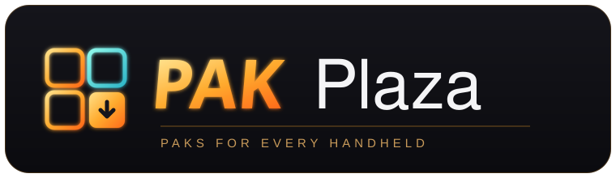

<p align="center">
  
</p>

<p align="center"><b>A catalog of paks for NextUI-based handhelds — one place, every device.</b></p>

<p align="center">
  <a href="https://retrotiv.github.io/Pak-Plaza/">🛒 Open the catalog</a> ·
  <a href="CREDITS.md">Credits</a>
</p>

---

## What this is

Pak-Plaza is a browsable store of **paks** — the little apps and tools that extend NextUI —
collected in one place and sorted **by device**. The catalog carries the community's
existing paks alongside the versions adapted here for other hardware, starting with the
**Anbernic RG353V** (adapted) and the **TrimUI Brick** (the original builds).

Pick your handheld at the top of the catalog and it shows only what runs on it. Every pak
card credits the original author and links back to the source.

## Why a "plaza"

Different handhelds, different builds of the same pak. Instead of hunting across repos and
threads, Pak-Plaza puts them side by side with a device switch, so you grab the build that
matches your console.

## Devices

- **Anbernic RG353V** — paks adapted for the RG353V (part of the
  [AnberNext](https://github.com/retrotiv/AnberNext) project).
- **TrimUI Brick** — the upstream community builds.
- **More to come** — the catalog is built to add devices as their builds land.

## The catalog

The storefront is a single page served by GitHub Pages, reading
[`paks.json`](paks.json). To **add or change a pak**, edit `paks.json` — no code:

```jsonc
{
  "name": "Game Manager",
  "category": "Scrapers",
  "desc": "Rename, archive and delete ROMs, and download box art.",
  "author": "UncleJunVIP",
  "source": "https://github.com/UncleJunVIP/nextui-game-manager",
  "availability": { "rg353v": "adapted", "brick": "original" }
}
```

`availability` maps a device id (`rg353v`, `brick`, `miyoo`, …) to either `adapted`
(a build made here for that device) or `original` (the upstream build). Add a new device
to the `devices` list and it appears as a switch automatically.

## A note on hosting and credit

These paks are the community's work. Pak-Plaza credits every original author on the card
and links to their source. Where only a link is shown, the build is hosted at its original
home; adapted RG353V builds are published through this project. If you are an author and
want your pak added, linked differently, or removed, open an issue — it will be handled
right away. See [CREDITS.md](CREDITS.md).
